<p align="center"></p>

<p align="center"><b>Lossless Scaling, extended.</b><br>DLSS 5 Neural Rendering, DLSS, FSR and XeSS upscaling for games that never had them, frame generation of our own (a prototype), a built-in recorder and GPU limit, and one window that keeps it all.</p>

<p align="center">
<a href="https://github.com/Echo-Storm/ls-addon-manager/releases/latest"><b>Download</b></a> &nbsp;·&nbsp; <a href="#quick-start">Quick start</a> &nbsp;·&nbsp; <a href="#install">Install</a> &nbsp;·&nbsp; <a href="#the-addons">The addons</a> &nbsp;·&nbsp; <a href="#built-in-features">Features</a> &nbsp;·&nbsp; <a href="CHANGELOG.md">Changelog</a> &nbsp;·&nbsp; <a href="docs/faq.md">Questions</a>
</p>

<p align="center">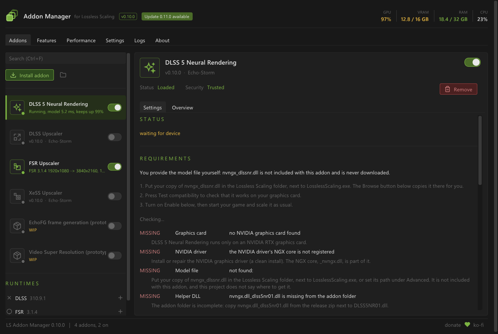</p>

**Addon Manager for Lossless Scaling** loads alongside [Lossless Scaling](https://store.steampowered.com/app/993090/Lossless_Scaling/) and gives it an addon system. What it adds, as addons you switch on and off:

- **Upscalers.** The **DLSS**, **FSR** and **XeSS Upscalers** put a real temporal upscaler in place of Lossless Scaling's NIS scaler, so a game that never had one gets one. They need no support from the game.
- **DLSS 5 Neural Rendering** gives any game a new look, on every frame Lossless Scaling shows (you provide the model file yourself, see below).
- **Video Super Resolution** for pictures that are not a game: **movies, images**, text and interface, sharpened by NVIDIA's RTX Video Super Resolution (an NVIDIA RTX card).
- **EchoFG**, our own frame generator, a prototype: in the package, off until you switch it on, and rough in places.

And built into the manager: a **recorder** that saves what the game showed (a clip that plays a problem back on another computer), a **GPU limit**, ReShade input passthrough, windowed mode, a **Performance tab** that says what limits your frame rate, backups of every setting, and updates. It is free, MIT-licensed and **unofficial**: not affiliated with the Lossless Scaling developers. Read the [disclaimer](DISCLAIMER.md) before installing.

[](https://github.com/Echo-Storm/ls-addon-manager/actions/workflows/build.yml)
&nbsp; **1.0.2** ([roadmap](ROADMAP.md)) &nbsp;·&nbsp; Lossless Scaling 3.2.2.0 &nbsp;·&nbsp; Windows 10 or 11, x64

> [!IMPORTANT]
> **DLSS 5 Neural Rendering needs a file you provide yourself:** your own copy of `nvngx_dlssnr.dll`. It is **not included**, this project **never downloads it**,
> and it does not say where to get it. Put it next to `LosslessScaling.exe` (Setup and the addon's **Browse for the model file...** button can copy it there), then
> press **Test compatibility** in the addon's panel. Everything else, the upscalers included, works without it.

## Quick start

1. Download the zip from the [releases page](https://github.com/Echo-Storm/ls-addon-manager/releases), unzip it, close Lossless Scaling and run **`LSAddonManagerSetup.exe`**. ([Install](#install) has the details.)
2. Start Lossless Scaling. The manager opens by itself.
3. In Lossless Scaling choose **NIS** as the **Scaling Type**, and run your game in a window **smaller than your screen** (for example 2560x1440 on a 4K screen).
4. In the manager's **Addons** tab switch on the upscaler for your card: **DLSS** on an NVIDIA RTX card, otherwise **FSR**.
5. Press **Ctrl+Shift+F7** in the game to flip between the upscaler and NIS and judge for yourself.

Something wrong? [If something goes wrong](#if-something-goes-wrong) and the [questions and answers](docs/faq.md) come first; the manager's **Settings** tab makes a diagnostics file for a report.

## What you need

| | |
|---|---|
| **Lossless Scaling** | 3.2.2.0 (the Steam version), on Windows 10 or 11, x64. The manager forwards to Lossless Scaling's own `Lossless.dll`; nothing is patched on disk. |
| **DLSS Upscaler** | An NVIDIA RTX graphics card. NVIDIA's runtime comes with the addon. |
| **FSR Upscaler** | Any DirectX 12 graphics card. AMD's runtimes (FSR 3.1.4 and FSR 4.1.1b) come with the addon. |
| **XeSS Upscaler** | Any card with Shader Model 6.4 (Intel Arc, NVIDIA, AMD). Intel's runtime comes with the addon. |
| **DLSS 5 Neural Rendering** | An NVIDIA RTX card and your own `nvngx_dlssnr.dll` (see above). |
| **EchoFG** (prototype) | Any DirectX 12 card. AMD's FSR 3.1 runtime, for its alternative way of making frames, comes with the addon. |
| **Video Super Resolution** | An NVIDIA RTX card. The files of NVIDIA's Video Effects SDK it needs come with the addon. |
| **Everything else** | Recording, GPU limit, ReShade passthrough, windowed mode and the update check are built into the manager: nothing more. |

**Tried with** World of Warcraft: Forever, Fallout: New Vegas (Tale of Two Wastelands), Silent Hill f (HDR) and Metro 2033 Redux, on an RTX 4070 Ti SUPER and Windows 11. Other games and cards are untested so far, and EchoFG, the prototype, has had the least use: reports are welcome.

> [!TIP]
> **New in 1.0.2: Video Super Resolution is out of prototype, made for movies and images** (it works on the whole picture by default, a picture that has not changed is not worked on again, and the NVIDIA files it needs come with it). **In 1.0.1:** heavy upscalers no longer take a game's frame rate under frame generation (issue #22: while the card is full, the frames Lossless Scaling generates get a much lighter upscaling; on by default); shaders are compiled once and kept, so the addons start without 1 to 5 seconds of compiling; EchoFG is in the package as a prototype; and **Setup leaves a file you have changed alone** (see [Install](#install)). The [changelog](CHANGELOG.md) has everything since 0.9.

## Contents

- [Quick start](#quick-start) · [What you need](#what-you-need) · [Install](#install)
- [The addons](#the-addons): [the upscalers](#the-upscalers-dlss-fsr-and-xess), [Neural Rendering](#dlss-5-neural-rendering), [Video Super Resolution](#video-super-resolution-movies-and-images), [EchoFG](#echofg-a-prototype) · [Built-in features](#built-in-features): recording, GPU limit, ReShade, windowed mode
- [The manager](#the-manager) · [Hotkeys](#hotkeys) · [Updates](#updates) · [If something goes wrong](#if-something-goes-wrong)
- [Documentation](#documentation) · [For developers](#for-developers): how it works, building, writing an addon, [research notes](#research-notes) · [Credits](#credits)

## Install

1. Download `LSAddonManager-<version>-x64.zip` from the [releases page](https://github.com/Echo-Storm/ls-addon-manager/releases) and unzip it.
2. Close Lossless Scaling and run **`LSAddonManagerSetup.exe`**. It finds your Lossless Scaling folder (Steam or not; otherwise choose **Use a different
   folder...**) and offers what fits: **Install**, **Update**, **Reinstall**, **Repair** or **Uninstall**.
3. Start Lossless Scaling. The manager opens by itself. Neural Rendering is on; every other addon is off until you switch it on.

<table>
<tr>
<td valign="top" width="50%"><b>Setup, before installing</b><br>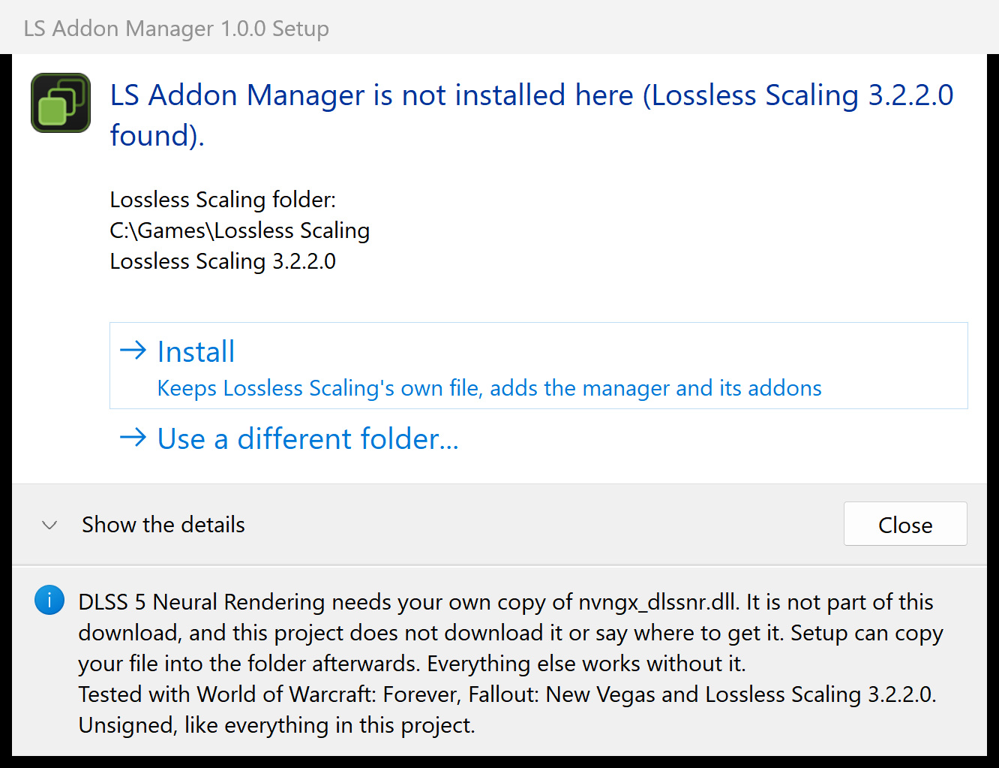</td>
<td valign="top" width="50%"><b>Setup, when it is done</b><br>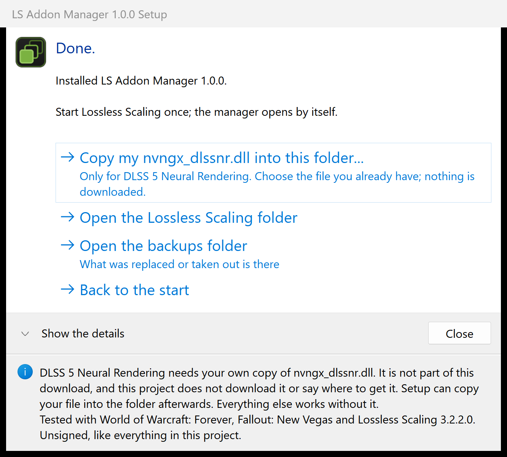</td>
</tr>
</table>

**What Setup does:**
- Keeps Lossless Scaling's own `Lossless.dll` as `Lossless_original.dll` (the manager forwards to it) and puts ours in, with the `addons` folder.
- **Backs up everything it replaces** into a `backups` folder, checks every file after copying, and puts the folder back as it was if anything fails.
- **Never touches your settings** or your other addons, and refuses to run while Lossless Scaling runs from that folder.
- **Overwrites every file of the addons it ships, except one you have changed.** Setup keeps a record of what it put in the `addons` folder. A file that is no longer what it put there last time (a newer runtime of your own under the same name, an edited `addon.json`) is left as it is, and Setup tells you which. **If you modified a file, or use a modified one, you have to remove that file to get our current version of it** (the rest of the update is applied either way): delete or rename it, then run Setup again (an update, or **Reinstall**) and it puts ours back.
- After a **Lossless Scaling update** (which may put its own `Lossless.dll` back), run it again: it offers **Repair**.
- Asks for administrator rights only when the folder needs them (Program Files, for example).

Like every file here, Setup is **unsigned**, so Windows SmartScreen may warn you: choose *More info*, then *Run anyway*. Its source is in [`installer/`](installer/).

<details>
<summary><b>Installing by hand</b></summary>

1. Close Lossless Scaling and open its folder (for Steam, for example `C:\Program Files (x86)\Steam\steamapps\common\Lossless Scaling`).
2. **First time only:** rename its `Lossless.dll` to `Lossless_original.dll`. Keep it: the manager forwards to it.
3. The files are inside Setup. In a command prompt in the unzipped folder, run `LSAddonManagerSetup.exe --extract files`: it writes them into a new
   `files` folder and changes nothing else. Copy `Lossless.dll`, the two `manager-icon` files and the `addons` folder from there into the Lossless Scaling folder.
4. Start Lossless Scaling.

**Updating:** extract the new release's files the same way and copy them over the old ones. **After a Lossless Scaling update:** delete the stale
`Lossless_original.dll`, rename the new `Lossless.dll` to `Lossless_original.dll`, and copy ours in again. **Uninstalling:** delete our `Lossless.dll`, rename
`Lossless_original.dll` back to `Lossless.dll`, and delete `addons` if you like.
</details>

## The addons

| | What it does | Needs | Starts |
|---|---|---|---|
| **DLSS Upscaler** | NVIDIA DLSS in place of NIS: upscaling, or DLAA at the screen's own size | NVIDIA RTX | off |
| **FSR Upscaler** | AMD FSR 3.1 or FSR 4 in the same place | any DirectX 12 card | off |
| **XeSS Upscaler** | Intel XeSS in the same place | any card with Shader Model 6.4 | off |
| **DLSS 5 Neural Rendering** | NVIDIA's neural rendering model on every frame Lossless Scaling shows: a new look for any game | NVIDIA RTX, your own model file | on |
| **EchoFG frame generation** (prototype) | Our own frame generator: 1 to 8 frames made between each two real ones | any DirectX 12 card | off |
| **Video Super Resolution** | NVIDIA's RTX Video Super Resolution in place of NIS, for movies, images and other pictures | NVIDIA RTX | off |

Only one upscaler runs at a time (switching one on switches the others off); any of them works beside Neural Rendering and EchoFG.

### The upscalers: DLSS, FSR and XeSS

<p align="center">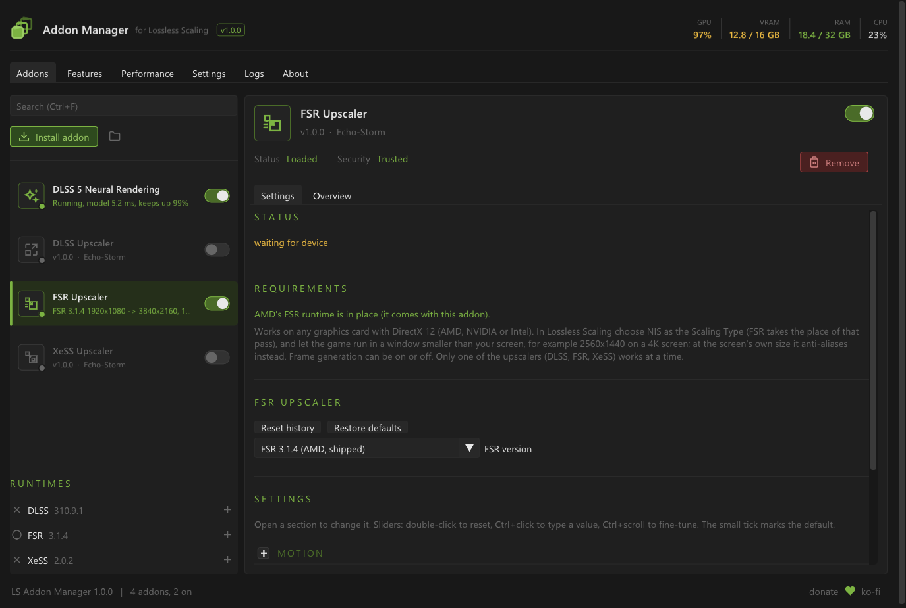</p>

Lossless Scaling scales a game window up to the screen one frame at a time. The upscalers put a **temporal upscaler** in its place: it reads several frames and
the motion between them, for a steadier picture with cleaner, smoother edges. The game needs no support for it: **the addons measure the motion from the frames themselves.**
What it cannot do is add detail the game did not render: a game gives its own upscaler a tiny camera shift every frame, which is where a temporal upscaler finds extra
detail, and Lossless Scaling's frames carry none. Measured on recordings (`docs/frame-generation-research.md`): where the picture moves the addons lean on a resample of the
frame (no trailing), and at rest the upscaler smooths (the **Sharpness at rest** slider trades some of that back for sharpness).

**To use one:** switch it on in the addon list, choose **NIS** as the Scaling Type in Lossless Scaling, and run the game in a window smaller than the screen
(for example 2560x1440 on a 4K screen). At the screen's own size it anti-aliases instead.

| | DLSS | FSR | XeSS |
|---|---|---|---|
| Runs on | NVIDIA RTX | any DirectX 12 card | any card with Shader Model 6.4 (Intel Arc, NVIDIA, AMD) |
| Versions | **Auto** (the default: model E at the screen's own size, L when upscaling), or K, L, J (DLSS 4), M (DLSS 4.5), E (DLSS 3) | FSR 3.1.4 (AMD's, signed) or FSR 4.1.1b (the OptiScaler team's build, on any card) | XeSS 2.0.2 (Intel's, signed) |
| Good at | smoothing edges | FSR 3: low cost, crisp text; FSR 4: motion | on Intel Arc it runs on the card's matrix units |
| Sharpening | ours | ours (AMD's RCAS is off by default) | ours |

<p align="center">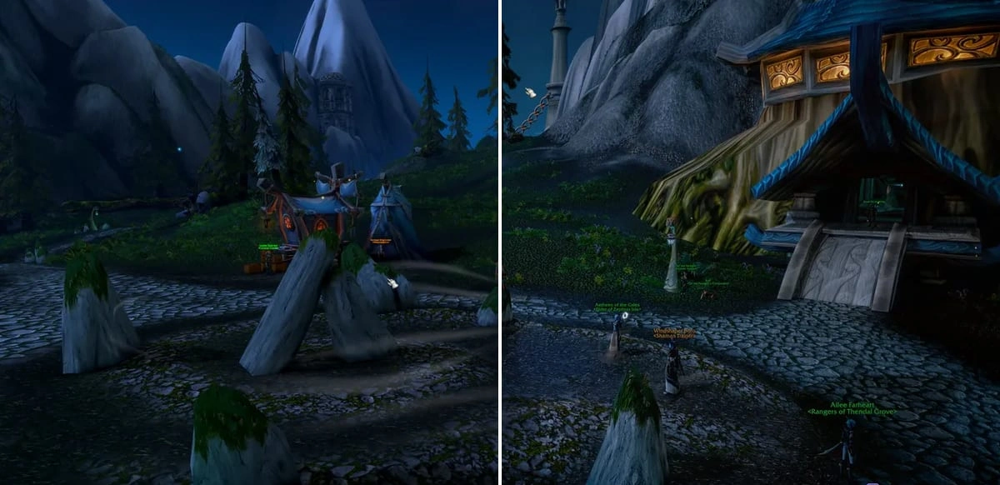</p>
<p align="center"><sub>World of Warcraft: Forever, 1080p scaled to 4K: a side-by-side shot.</sub></p>

**Which one?** On an NVIDIA RTX card, try DLSS and FSR 4. On any other card, FSR, and XeSS on Intel Arc. All three are tried in World of Warcraft.

What all three do:
- **Every presented frame**, real and generated, with frame generation on or off. With frame generation on, the generated frames get a lighter upscaling while the card is full (on by default).
- **HDR games** (scRGB and HDR10) in the upscaler's own HDR mode, highlights kept; *Frame encoding* overrides the automatic choice.
- **4:3 and other window shapes**, upscaled into the part of the screen Lossless Scaling uses, borders left alone.
- **Steady in fast motion:** Lossless Scaling gives an upscaler none of the camera jitter a game gives it, so in motion its memory of
  earlier frames only trails; where the picture moves, ours leans on the new frame (**Lean from** sets from how much motion).
- **Stability** (less shimmer on wires and leaves), **edge smoothing** for games without anti-aliasing, and **sharpening** well past the upscaler's own.
- **Colour and tone** (vibrance, saturation, shadows, highlights, brightness, contrast, gamma), applied before upscaling, so they cost nothing.
- **Settings per game**, which come back when the game takes focus.
- **Before / after** against NIS while you play, and a line of live numbers.

What they cost on an RTX 4070 Ti SUPER, everything included (the 1:1 row: 0.9.14, live in World of Warcraft, the motion estimate included):

| | DLSS | FSR 3.1 | XeSS |
|---|---|---|---|
| 1920x1080 -> 3840x2160 | | about 1.5 ms | not measured yet |
| 2560x1440 -> 3840x2160 | about 2.4 ms | about 1.85 ms | not measured yet |
| 3840x2160 at 1:1 (anti-aliasing) | about 4.2 ms (model E) | about 3.3-3.7 ms | about 2.7-2.8 ms |

FSR 4 costs more than FSR 3.1; the panel's status line shows what it takes on your card. If the game has its own anti-aliasing (MSAA), switch it on: it
draws what no upscaler can put back. The [upscalers' guide](addons/DLSS5NR01/docs/upscalers.md) covers every setting.

### DLSS 5 Neural Rendering

<p align="center">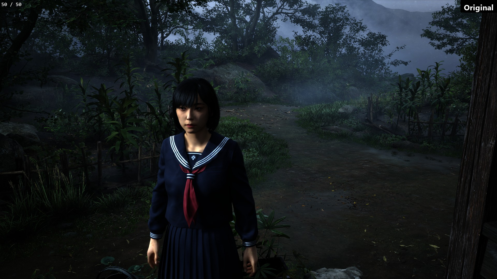</p>
<p align="center">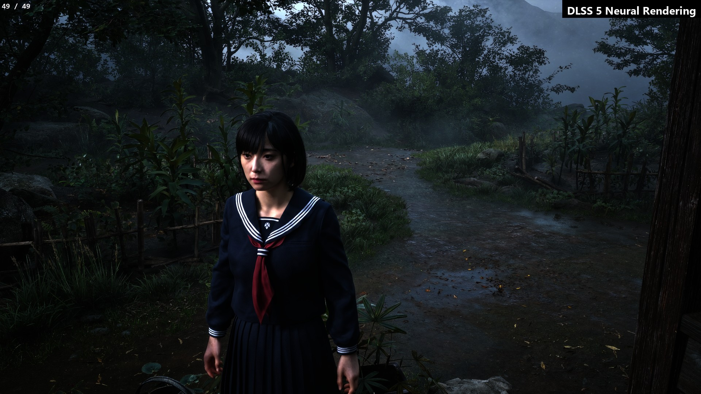</p>
<p align="center"><sub>Silent Hill f (Unreal Engine 5, HDR) through Lossless Scaling: the original above, DLSS 5 Neural Rendering below.</sub></p>

Runs NVIDIA's DLSS 5 neural model on Lossless Scaling's frames and puts the result on **every frame it presents, real and generated**, without ever making
Lossless Scaling wait. It needs your own `nvngx_dlssnr.dll` (see the note at the top).

- **Frame generation on or off.** With it on, the model's result is carried onto the generated frames along the motion; with it off, the model takes the presented frames.
- **Its own motion measurement**, per pixel, so the picture holds together while the camera turns.
- **Looks:** saved sets of sliders, a look per game that follows the game in focus, and a hotkey to cycle them.
- **Keep the HUD untouched:** draw the areas the model must leave alone (action bars, chat, the minimap) on a snapshot of the game.
- **Picture controls:** intensity, fine detail, local contrast, skin detail, sharpening, tone, colour, shadows and highlights, film grain, temporal smoothing,
  and a ghost guard where the motion cannot be trusted.
- **HDR games** (scRGB and HDR10), with only the model's change put back, so highlights keep their brightness.
- **Compare while you play:** before / after, a split view, and before / after pictures (see [Hotkeys](#hotkeys)).
- **Model preset:** with NVIDIA's runtime 310.9.16 or newer, *Newer* (the default: about 40 % less model time, a gentler effect) or *Older* (the original look, the old cost); a model file older than that has only the older one.
- **Auto quality** keeps the model within a time budget (and follows the manager's [GPU limit](#built-in-features)); a **compatibility test** tries the model on your card before you play.

About 5 to 9 ms a frame on an RTX 4070 Ti SUPER with a 1912x1080 model input (8.5 ms at 4K in World of Warcraft). [The addon's README](addons/DLSS5NR01/README.md) has the details.

<p align="center"></p>

### Video Super Resolution: movies and images

NVIDIA's RTX Video Super Resolution in place of Lossless Scaling's NIS, for **anything that is a picture rather than a game**: a film or a video in your player, photographs and images in a viewer, slides, text, an interface. It is a trained network that sharpens what it upscales, one picture at a time, so text and fine detail come out crisp where the temporal upscalers above can only stay smooth.

- **Use it:** switch it on in the addon list, choose **NIS** as the Scaling Type and show the picture in a window smaller than the screen (a player at 1920x1080 on a 4K screen). It needs an NVIDIA RTX card; the files of NVIDIA's Video Effects SDK it uses come with the addon, in its `vfx` folder, with NVIDIA's licences.
- **Cheap on a picture that does not change.** A still image, a paused video, or a film at 24 or 30 pictures a second shown at 60 Hz or more gives the same picture to many frames in a row: the addon compares each with the one VSR last worked on, on the card, and only works on a new one, so a film at 24 fps runs VSR 24 times a second, not 60, and a still image once. (About 2.3 ms for a picture at 1440p to 4K on an RTX 4070 Ti SUPER, about 0.5 ms for a repeat.)
- **For a game** it has a motion gate (NIS stays where the picture moves) and a time limit between runs, but a game that moves a lot is better served by the upscalers above. VSR takes an 8-bit picture, so an HDR film loses highlights above the SDR white; for HDR, the temporal upscalers keep them.
- Details, costs and settings: [`addons/DLSS5NR01/docs/vsr.md`](addons/DLSS5NR01/docs/vsr.md).

### EchoFG, a prototype

**EchoFG** is **our own frame generator**, in the package and **off until you switch it on**. It works and it is measured, but it has been used in far fewer games than the rest: expect rough edges, and tell us what you find. With Lossless Scaling's own frame generation **off**, it shows 1 to 8 frames made between each two real ones, evenly spaced, in Lossless Scaling's window; choose **NIS** as the Scaling Type. It makes the frames with its own shaders from this project's own motion estimate (per pixel, with a correction for repeating patterns such as fences and a lighter analysis on 4K frames), or, as an alternative, with AMD's FSR 3.1 frame generation fed that motion; it holds a HUD that stays put while the picture turns. It works beside the upscalers or without them. The real frames are shown about one frame later than without it. Measured offline on real recordings it scores at least as well as FSR 3.1 and clearly better than a plain blend ([`docs/own-generator-plan.md`](docs/own-generator-plan.md), which also says how the scores behave at very fast motion); what is still open is how it compares with Lossless Scaling's own frame generation on a real screen, and its pacing on every display.

### Built-in features

Built into the manager, on its **Features** tab. Recording and the GPU limit work for every addon; each feature has its own switch.

| Feature | What it does |
|---|---|
| **Recording** | Press **Ctrl+Shift+F1** (any F-key you choose): a tick the moment you press, a rising pair when the clip is saved, a low tone when there was nothing to save. The clip is a `.lsrec` file that plays the problem back on another computer, with a note beside it (`<file>.lsrec.json`: the game, the picture, which addons were on and their main settings). It finds Lossless Scaling's frames itself, so **no addon has to be on**, and with frame generation off it records the frame the scaling pass reads. *Compact* (the default) turns HDR frames into an 8-bit picture on the card first: a ten-second clip is about 1 GB and saved in seconds; *Exact* keeps every frame as captured. *Keep going after the key* saves a few seconds after the press. |
| **GPU limit** | Keep the graphics card under 80 to 100 % (95 % by default). The manager reads the load of the card Lossless Scaling runs on (NVML on NVIDIA, Windows' counters on any other card) and tells the addons: Neural Rendering's Auto quality takes the model's working size down, and the upscalers' lighter mode for generated frames starts, while the load stays at or over the limit; they go back when it is well under. |
| **ReShade input passthrough** | Mouse and keyboard reach a ReShade overlay while Lossless Scaling scales the game. **Home** turns it on and off. |
| **Windowed mode and second monitor** | A virtual display the size of your game window, so Lossless Scaling works with a windowed game or on a second monitor, with split-screen and side-by-side options. Switching it on needs a restart of Lossless Scaling. |

<p align="center">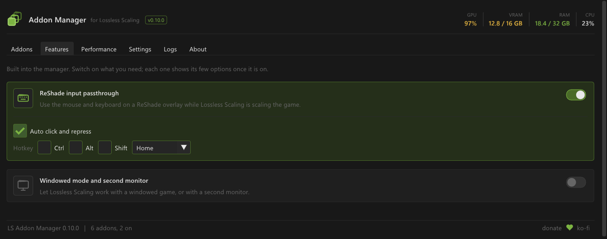</p>

Each feature shows its few options once it is switched on.

## The manager

- **The machine at a glance:** the header shows the graphics card's load and memory, system memory and the processor, on every tab.
- **A Performance tab that explains itself:** frame rate and frame times, what each addon costs, the GPU's load, power, clocks, temperature and memory, and a
  plain-words reading such as "the GPU is at its power limit".
- **Addons without touching folders:** install from a folder, a zip or a DLL (or drop one on the window); *Remove* moves an addon aside, nothing is erased.
- **Runtimes list:** every file the addons run on (DLSS, FSR, XeSS, your model) with its version, whether it is loaded, and whether it is signed as its maker
  shipped it. **+** switches to another file while the game runs.
  <p align="center">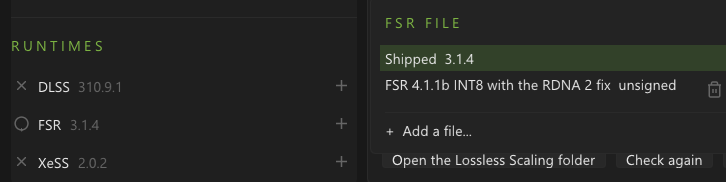</p>
- **Record a bug:** the manager keeps the last few seconds of frames and saves them, with a note, as a file that plays the problem back on another computer (the Recording feature above).
- **Stays out of the way:** it opens with Lossless Scaling, hides to the notification area, and comes back with a click or **Ctrl+Shift+F12**.
- **Back up and restore** every setting to one file, and a **diagnostics zip** of logs and settings for a bug report (nothing is uploaded).
- **Safe by design:** a faulting addon cannot take Lossless Scaling down, settings are written atomically, and optional SHA-256 checks guard addon DLLs.
- **Interface size** from 75% to 200%, sharp on any display.

| Tab | What is on it |
|-----|--------------|
| **Addons** | The addon list with a switch, icon and live status for each, the Runtimes list, and the chosen addon's settings |
| **Features** | Recording, GPU limit, ReShade input passthrough and Windowed mode |
| **Performance** | Frame times, addon cost, GPU load, power, clocks, temperature, memory, and what is limiting you |
| **Settings** | Backup and restore, interface size, start-up and hotkey, updates, security, log detail, the diagnostics file |
| **Logs** | The last 10,000 log entries, filtered by level |
| **About** | What comes with it, version and updates, credits |

Closing the window stops nothing: the manager hides to the notification area (Windows may keep its icon under the ^ arrow by the clock).

<table>
<tr>
<td valign="top" width="50%"><b>Performance</b><br>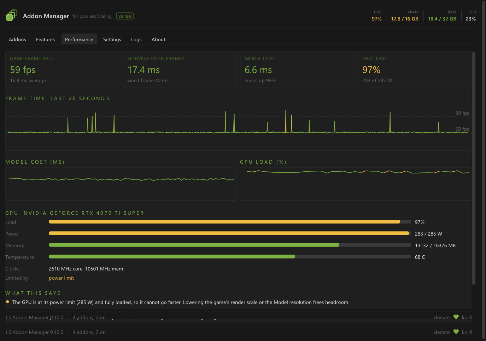</td>
<td valign="top" width="50%"><b>Settings</b><br>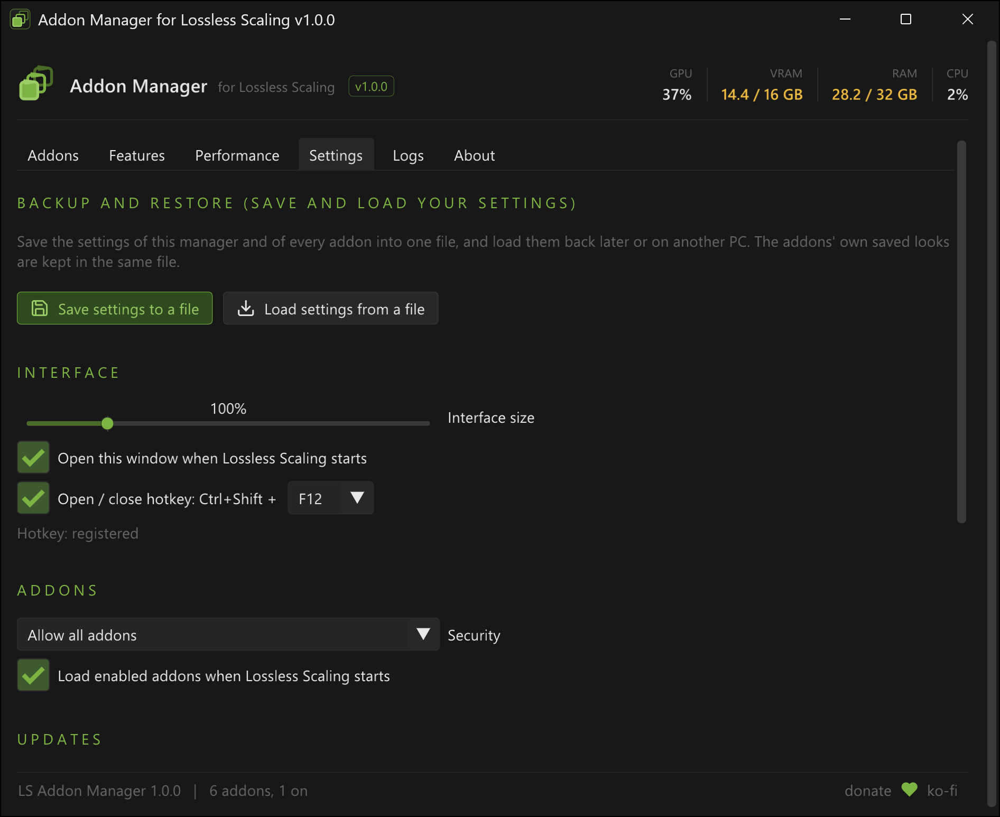</td>
</tr>
</table>

## Hotkeys

They work while the game has focus. The game sees the key too, so the defaults keep away from keys games often use alone (F5, F6, F9, F11). If one
clashes in your game, change it in the addon's *Compare and hotkeys* section.

| Keys | What they do | Where |
|------|--------------|-------|
| Ctrl+Shift+F12 | Show or hide the manager | the manager |
| Ctrl+Shift+F7 | Before / after: the original (or NIS) against ours | every addon |
| Ctrl+Shift+F8 | Split view: the original at the left, ours at the right | Neural Rendering |
| Ctrl+Shift+F2 / F3 | Sharpening down / up | every addon |
| Ctrl+Shift+F4 | Before / after pictures: two PNGs of the same moment, with and without the addon | every addon |
| Ctrl+Shift+F10 | The next saved look | Neural Rendering |
| Ctrl+Shift+F9 | Steps through Lossless Scaling's NIS and the upscalers that are on, one at a time, with a label that names the upscaler and its runtime version (a temporary test; not configurable, so do not bind F9 to anything else) | the upscalers |
| Ctrl+Shift+F1 | Save the recording (the last few seconds; or, with the recorder's *Keep the last few seconds* off, record the next ten and save them). The key can be any of F1 to F12 | the manager (Features tab, *Recording*) |
| Home | ReShade input passthrough on and off | the manager |

## Updates

At start-up (if the last check is over an hour old) and then once a day while it stays open, the manager asks GitHub whether there is a newer release (**on by default**;
*Settings > Updates* turns it off, *Check now* always works). It waits while a game is being scaled, so nothing is shown over a game. When there is one, it asks once, and
an **Update available** badge stays in the header (also after *Not now*) to open the offer again:

- **Download and install** downloads the release, checks its size and SHA-256 against GitHub's (a download GitHub lists no SHA-256 for is refused: use the release page) and that the Setup inside is that version. Then you choose:
  **Close it and install** asks Lossless Scaling to close itself (as its window's X would; any scaling in progress ends) and Setup updates it and starts it
  again; **Install when I close it** leaves the closing to you and Setup waits. If Lossless Scaling does not close when asked (a dialog open in it), the offer says
  so and gives **Ask again** and **End it now**. Your settings carry over, and the Setup that runs is hashed again just before it starts.
- **Not now** asks again after the next check; **Don't ask again for this release** waits for a newer one (the About tab still offers it).

<table>
<tr>
<td valign="top" width="50%"><b>The offer</b><br>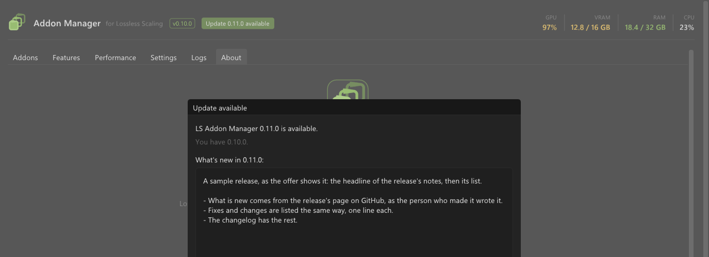</td>
<td valign="top" width="50%"><b>Downloaded and checked</b><br>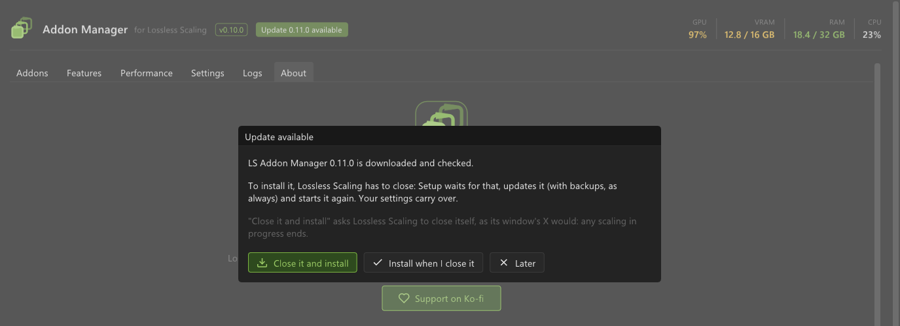</td>
</tr>
</table>

(The pictures show a sample release.)

That check, and a download you ask for, are the only times the manager goes online. To update by hand, download the zip and run Setup: it offers **Update**. Setup replaces every file it ships except one you have changed (see [Install](#install)).

## If something goes wrong

| What you see | What to do |
|--------------|-----------|
| The manager does not appear | It may be hidden: look under the ^ arrow by the clock, or press Ctrl+Shift+F12. If not, a Lossless Scaling update may have put its own `Lossless.dll` back: run Setup and choose **Repair**. |
| Setup says Lossless Scaling is running | Close it (also from its notification-area icon), then press **Check again**. |
| Setup does not find your Lossless Scaling folder | Choose **Use a different folder...** and pick the folder that holds `LosslessScaling.exe`. Setup remembers it. |
| After an update, an addon still behaves like the old version | Setup leaves a file you changed (or a runtime of your own under the same name) as it is, and says which. Delete or rename that file and run Setup again (**Reinstall**): it puts ours back. |
| SmartScreen or your antivirus objects to a file, or flags the zip as a trojan | The files are not signed, and a new unsigned file that replaces a DLL looks suspicious to a cloud check; it is a false positive. [What to do](docs/antivirus.md): compare the SHA-256 on the release page, build it yourself, or allow it. If your antivirus removes `nr_selftest.exe`, only *Test compatibility* stops working. |
| Neural Rendering says the model file is missing | It needs your own `nvngx_dlssnr.dll` next to `LosslessScaling.exe`: use **Browse for the model file...**, then **Test compatibility**. |
| An upscaler is on but the picture looks like NIS | Choose **NIS** as the Scaling Type in Lossless Scaling. The panel's status line says what the upscaler is doing. |
| The frame rate drops a lot with DLSS or FSR 4 and frame generation | Since 1.0.1 the generated frames get a lighter upscaling while the card is full (the panel's *Lighter upscaling of generated frames when the card is full*, on by default). A frame cap with some headroom helps too. [Questions and answers](docs/faq.md). |
| The DLSS Upscaler names a card that is not NVIDIA's | Lossless Scaling runs on that card. Set its **Preferred GPU** to your NVIDIA card, or use the FSR or XeSS Upscaler, which run on any card. |
| FSR 4 looks wrong, costs too much or does not start | Set *FSR version* back to **FSR 3.1.4** in the FSR Upscaler's panel. A chosen file that goes missing falls back to the shipped one by itself. |
| An addon says its runtime "stopped responding" | Lossless Scaling carries on without the addon. Choose another runtime with **+** in the Runtimes list, restart Lossless Scaling, and send us the addon's log. |
| An HDR game looks washed out, too dark or too bright | Set **Frame encoding** (the bottom of the Upscaling section) to HDR or SDR by hand, and tell us which it needed. |
| Windowed mode does nothing | Restart Lossless Scaling after switching it on: its virtual display must exist before Lossless Scaling starts. |
| Something looks wrong in a game | Switch on *Recording* in the manager's **Features** tab, make it happen, press **Ctrl+Shift+F1** (it beeps when the file is saved), and attach the `.lsrec` file (in `Videos\Lossless Scaling`, or the folder you chose there) and the `.lsrec.json` note beside it to your report. |
| Stutter or uneven pacing | Look at the **What stands out** lines under *Status* in the addon's panel: they say in plain words whether the game's own frames are uneven, whether the graphics card is full, and what to try. For a report, make it happen, press **Ctrl+Shift+F1** (or close Lossless Scaling), and send the addon's log and `logs\frame-trace-<addon>.csv` from the Lossless Scaling folder: it is a timeline of the frames (`python tools/analyze_frame_trace.py <csv>` reads it). |
| Anything else | See the [questions and answers](docs/faq.md). To report a bug, make a **diagnostics file** on the Settings tab. To undo everything, run Setup and choose **Uninstall**. |

<details>
<summary><b>The files it keeps</b></summary>

All inside the Lossless Scaling folder, except the recordings and the shader cache.

| File | What |
|------|------|
| `addons\config.json` | Every addon's state and settings, and the manager's. Written atomically; an unreadable one is kept as `config.json.corrupt`. |
| `addons\.installed-files.txt` | What Setup put in the `addons` folder (a hash a file), so an update can tell a file you changed from one it put there. Safe to delete: the next update then keeps any file that differs from a release's own. |
| `addons\trusted_addons.json` | Optional: `{ "<addon id>": ["<sha256 of its DLL>"] }`, for the Security setting. |
| `addons\.removed\` | Addons you removed, each in a folder with a timestamp. |
| `addons\<addon>\runtimes\` | Runtime files added with **+** in the Runtimes list (and the FSR 4 build), one folder each. Updates leave them alone. |
| `backups\` | What Setup replaced, and settings saved before a restore replaced them. |
| `logs\` | `LSAddonManager.log` and each addon's own (`DLSS5NR01.log`, `DLSS4DLAA.log`, `FSR3UPSC.log`, `XESSUPSC.log`, ...); the manager's rolls over to `.old` at 8 MB. |
| `Videos\Lossless Scaling\*.lsrec` | Recordings, in your Videos folder. |
| `%LOCALAPPDATA%\LSAddonManager\shader-cache` | The addons' compiled shaders (about half a megabyte; files unused for 90 days are removed). Safe to delete. |
</details>

## Documentation

[`docs/README.md`](docs/README.md) is the map of everything written down here. The ones to know:

- [Questions and answers](docs/faq.md) and the [Neural Rendering user guide](addons/DLSS5NR01/docs/user-guide.md): first run, what to expect, short answers.
- [The upscalers' guide](addons/DLSS5NR01/docs/upscalers.md): every setting, what it costs, how to compare.
- [Model compatibility](docs/model-compatibility.md) and [antivirus](docs/antivirus.md): which model files run, and why a download may be flagged.
- [Writing an addon](docs/addon-authors.md), [what the API keeps stable](docs/api-compatibility.md) and the [sample addon](examples/SampleAddon).
- [Changelog](CHANGELOG.md) and [roadmap](ROADMAP.md).

## For developers

### How it works

```
LosslessScaling.exe
  └─ loads Lossless.dll          <- the manager, in the original's place
       ├─ loads Lossless_original.dll (the real engine) and forwards its exports untouched
       ├─ watches Direct3D 11 compute work and shader loading, for addons that ask
       ├─ loads the addons from addons\
       └─ draws its window with Dear ImGui on its own thread
```

Nothing in Lossless Scaling is patched on disk, and removing the manager puts everything back. Addons share the manager's Dear ImGui context, so their
settings appear inline in the same look.

The addons do their GPU work on a Direct3D 12 device of their own, beside Lossless Scaling's Direct3D 11 one; they share textures and fences, every wait
between them is a GPU wait, and NVIDIA's, AMD's and Intel's code runs on a thread of the addon's own, so Lossless Scaling's render thread never stops for
an addon. Neural Rendering hooks the frame Lossless Scaling captures or presents; the upscalers recognise its NIS pass and put their picture in its output.
The [architecture notes](addons/DLSS5NR01/docs/architecture.md) have more.

### Building

Visual Studio 2022 (Desktop C++) and CMake 3.20+. Dear ImGui and MinHook are fetched at pinned versions on first configure.

```powershell
powershell -File tools\build_all.ps1              # the manager and the addons (-Only host: the manager only)
powershell -File tools\run_addon_tests.ps1        # the offline tests for what changed (-All: everything)
powershell -File tools\ci.ps1                     # what the GitHub build runs: manager, installer, sample addon, and the tests that need no GPU
python tools\run_hosttest_matrix.py --jobs 1      # the addons on a hidden swap chain, scenario by scenario (GPU; an idle machine)
python tools\bump_version.py 1.0.1                # every place that holds the release number (dry run; --apply writes)
powershell -File tools\package.ps1                # the release zip, with Setup built around the files
powershell -File tools\deploy.ps1 -What all       # copy a build into a Lossless Scaling folder, with backups
```

The addons also need their vendors' SDKs, which are not in this repository. Each script fetches from the vendor's own repository and checks what it gets:

| Script | What | Licence |
|--------|------|---------|
| `tools\fetch_ngx_sdk.ps1` | NVIDIA's DLSS SDK (headers, static library, `nvngx_dlss.dll`), after you accept NVIDIA's licence | NVIDIA's |
| `tools\fetch_ffx_sdk.ps1` | AMD's FidelityFX runtime, FSR 3.1.4 (pinned SHA-256, AMD's signature); the headers are in `third_party/ffx` | MIT |
| `tools\fetch_fsr4.ps1` | FSR 4.1.1b, the OptiScaler team's build (pinned SHA-256; needs 7-Zip) | AMD's FidelityFX SDK licence |
| `tools\fetch_xess_sdk.ps1` | Intel's XeSS SDK 3.0.2 (headers, `libxess.dll`; pinned SHA-256s, Intel's signature) | Intel Simplified Software License |

The offline test host and its scenarios (`tools\run_hosttest_matrix.py`) exercise every addon path without Lossless Scaling or a game. The full suite (`ci.ps1` and the
host matrix) is run once, on a release; day to day, `dev.py test changed` runs what a change touches. Every script lives in [`tools/`](tools/), and the [tools README](tools/README.md) lists all of them, with the test programs that sit beside their code.

### Research notes

Written down so they are not lost; none of it is in a product unless a release note says so.

- [`docs/frame-generation-research.md`](docs/frame-generation-research.md) and [`docs/own-generator-plan.md`](docs/own-generator-plan.md): measuring frame generators on recordings (EchoFG, our own, a prototype in the package).
- [`docs/mfg-super-motion-study.md`](docs/mfg-super-motion-study.md): what another project's public files tell about driving NVIDIA's frame generation from outside a game, and a measured head to head (DLSS-G, FSR 3.1 and EchoFG on the same recordings: EchoFG at least as good as FSR, both clearly ahead of DLSS-G fed our motion and a flat depth). Lab: [`tools/dlssg_probe`](tools/dlssg_probe).
- [`docs/optical-flow-study.md`](docs/optical-flow-study.md): NVIDIA's optical flow hardware against our flow estimator (ours is better; the hardware is cheaper). Lab: [`tools/flowlab`](tools/flowlab).
- [`docs/model-compatibility.md`](docs/model-compatibility.md): the Neural Rendering model files seen working, and what each looked like.

### Writing an addon

**Addons written for LosslessProxy load unchanged:** the interface began as LosslessProxy's and has only grown at the end. An addon with a settings panel
should still be rebuilt against this SDK (`manager/sdk/include/eam`), since the manager pins its own Dear ImGui; if a panel faults anyway, the manager
switches that panel off instead of going down with it.

Start from the [sample addon](examples/SampleAddon), a small, tested addon with settings, a panel, a status line and a metric. Then read
[docs/addon-authors.md](docs/addon-authors.md) for the exports, the host interface and the shared look, and [docs/api-compatibility.md](docs/api-compatibility.md)
for what the 1.0 interface promises.

## Credits

This project began as [LosslessProxy](https://github.com/FrankBarretta/LosslessProxy) by **FrankBarretta**, with thanks: its proxy `Lossless.dll` with addons,
its addon interface and the ReShade and Windowed features. The manager has since been rewritten; about a tenth of its lines still match the original's.
Neural Rendering began as **andreiday**'s DLSS 5 plugin for LosslessProxy and has been rewritten and extended here.

The upscalers run NVIDIA DLSS, AMD FidelityFX Super Resolution (FSR 4 as built by the OptiScaler team, with thanks) and Intel XeSS; their motion measurement,
stability and edge smoothing are this project's own. The full list, with licences, is in [NOTICE.md](NOTICE.md). NVIDIA, DLSS, AMD, FidelityFX, FSR, Intel and
XeSS are trademarks of their owners; this project is not affiliated with or endorsed by them. Lossless Scaling belongs to its author; this project is unofficial.

If it is useful to you, you can [support it on Ko-fi](https://ko-fi.com/xechostormx).

[MIT licence](LICENSE) · [Changelog](CHANGELOG.md) · [Roadmap](ROADMAP.md) · [Questions and answers](docs/faq.md)
